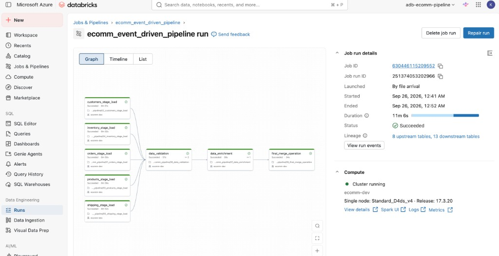
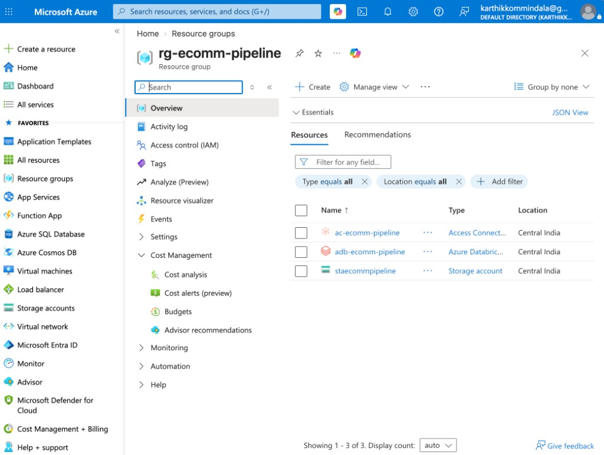
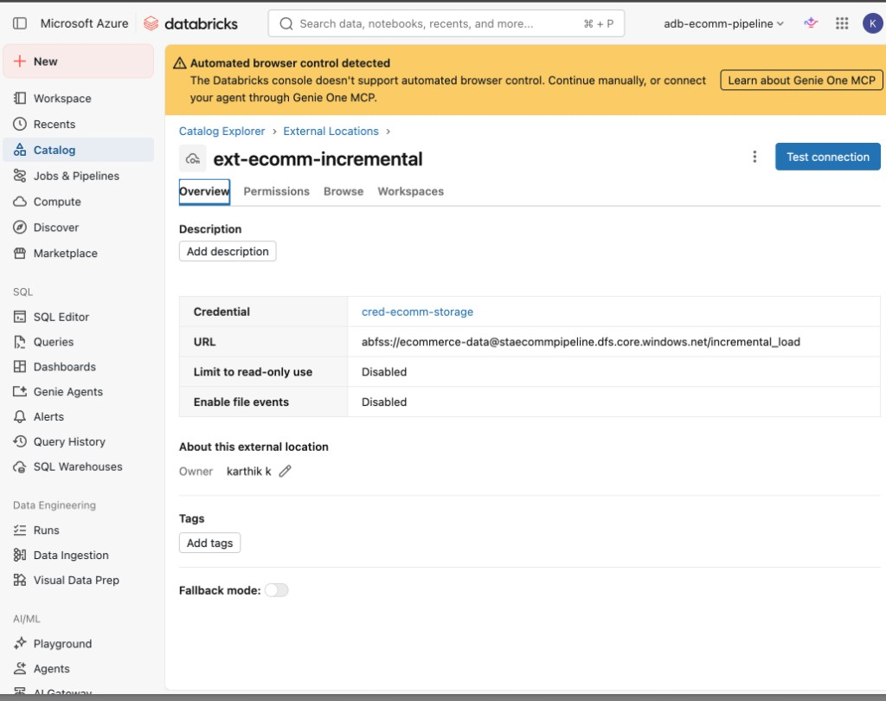
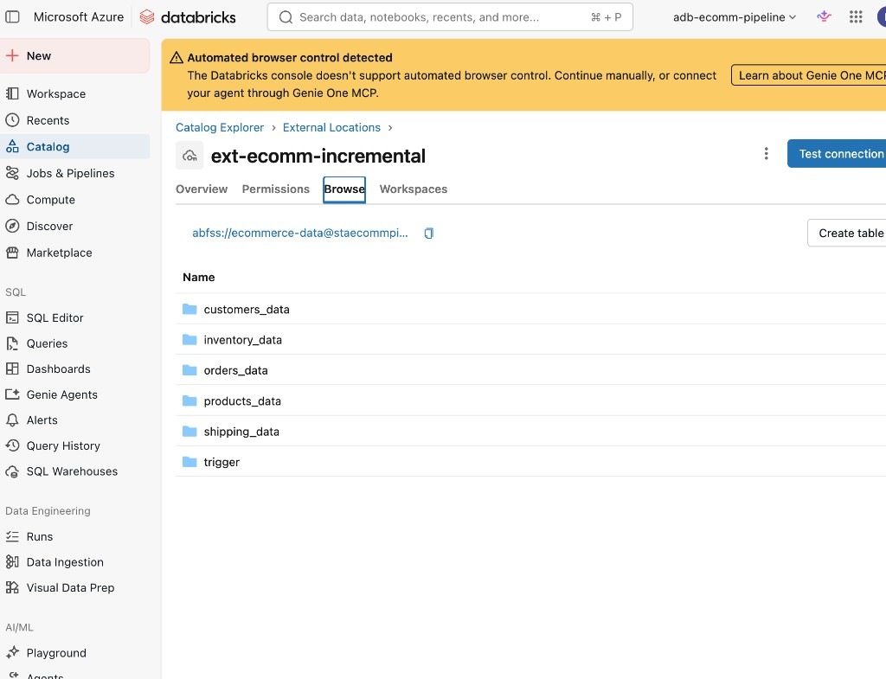
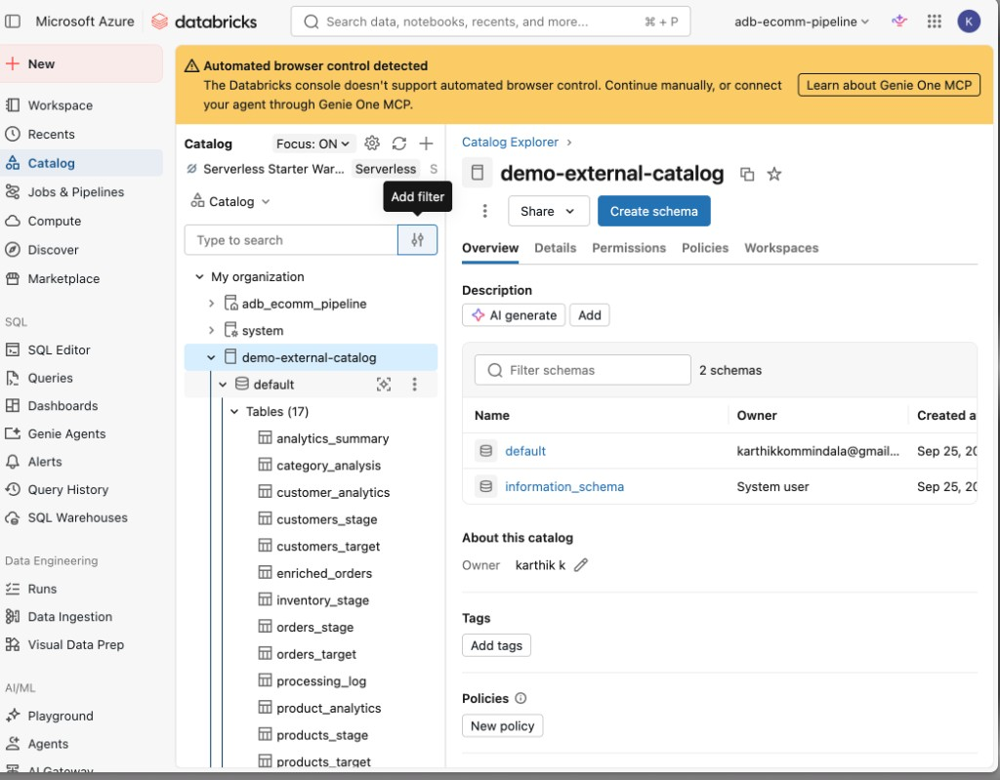

# E-commerce Event-Driven Data Pipeline

Azure Databricks lakehouse pipeline that ingests multi-domain e-commerce CSV batches from **ADLS Gen2**, validates and enriches them with **PySpark + Delta Lake**, applies **SCD Type 2** merges, and runs automatically on a **file-arrival trigger**.



*Live run: `ecomm_event_driven_pipeline` — launched by file arrival, 8 tasks, status Succeeded (~11 min).*

---

## Highlights

- **Event-driven orchestration** — Databricks Workflow watches `/Volumes/.../trigger/` and starts when a trigger JSON arrives
- **Azure-native storage integration** — Access Connector → Storage credential → External location → External Volume (no keys in code)
- **Unity Catalog** — catalog `demo-external-catalog`, governed tables + volume
- **Medallion-style processing** — landing CSV → Delta staging → validated/enriched → SCD2 targets + analytics
- **Parallel stage loads** — orders, customers, products, inventory, shipping load concurrently before validation

## Tech stack

| Area | Tools |
|---|---|
| Cloud | Azure Resource Group, Storage Account (ADLS Gen2), Access Connector |
| Platform | Azure Databricks (Premium), Unity Catalog, Workflows |
| Processing | PySpark, Delta Lake |
| Orchestration | Multi-task Job + file-arrival trigger |
| Languages | Python, SQL, JSON |

## Architecture

```text
ADLS Gen2 (CSV + trigger JSON)
        │  Access Connector / External Location
        ▼
Unity Catalog Volume  →  Workflow (file arrival)
        │
   ┌────┴────┐
   │ 01–05   │  parallel stage loads
   └────┬────┘
        ▼
   06 validation → 07 enrichment → 08 SCD2 merge + analytics
```

Details: [docs/ARCHITECTURE.md](docs/ARCHITECTURE.md)

### Azure foundation



| Resource | Name | Role |
|---|---|---|
| Resource group | `rg-ecomm-pipeline` | Central India |
| Databricks workspace | `adb-ecomm-pipeline` | Compute + Jobs + UC |
| Storage account | `staecommpipeline` | ADLS Gen2 landing zone |
| Access Connector | `ac-ecomm-pipeline` | Managed identity for storage access |

### Storage ↔ Databricks link



- **Credential:** `cred-ecomm-storage`
- **External location:** `ext-ecomm-incremental`
- **URL:** `abfss://ecommerce-data@staecommpipeline.dfs.core.windows.net/incremental_load`



Landing layout under the external volume:

```text
incremental_load/
  orders_data|customers_data|products_data|inventory_data|shipping_data/
    source/    ← drop new CSVs here
    archive/   ← notebooks move processed files here
  trigger/     ← file-arrival trigger path
```

### Unity Catalog outputs



Examples of tables produced by the pipeline:

| Kind | Tables |
|---|---|
| Staging | `orders_stage`, `customers_stage`, `products_stage`, `inventory_stage`, `shipping_stage` |
| SCD2 targets | `orders_target`, `customers_target`, `products_target`, … |
| Analytics | `enriched_orders`, `customer_analytics`, `product_analytics`, `analytics_summary`, … |
| Ops | `processing_log` |

---

## Repository layout

```text
├── data/                  # Sample Day-15 / Day-16 CSVs + trigger JSON
├── docs/
│   ├── ARCHITECTURE.md
│   └── screenshots/       # Live Azure + Databricks proof
├── infra/
│   └── main.bicep         # Optional Databricks workspace IaC starter
├── notebook/
│   ├── 00_setup.py        # Catalog / volume folders / processing_log
│   ├── 01–05_*_stage_load.ipynb
│   ├── 06_data_validation.ipynb
│   ├── 07_data_enrichment.ipynb
│   └── 08_final_merge_operation.ipynb
├── workflow/
│   └── ecomm_pipeline_job.json
├── LICENSE
└── README.md
```

---

## Pipeline notebooks

| # | Notebook | Purpose |
|---|---|---|
| 00 | `00_setup.py` | One-time catalog, volume folders, `processing_log` |
| 01–05 | `*_stage_load` | Read CSV → validate → Delta stage → archive files |
| 06 | `data_validation` | Cross-table + business-rule checks |
| 07 | `data_enrichment` | Joins + customer/product metrics |
| 08 | `final_merge_operation` | SCD2 merges + analytics summary tables |

Workflow task graph (parallel 01–05 → 06 → 07 → 08) matches [workflow/ecomm_pipeline_job.json](workflow/ecomm_pipeline_job.json).

---

## How to run (demo)

### Prerequisites

- Azure subscription
- Azure Databricks workspace (**Premium**, Unity Catalog)
- ADLS Gen2 storage account + container
- Databricks Access Connector with **Storage Blob Data Contributor** on the storage account

### 1. Wire storage into Unity Catalog

1. Create **Storage credential** (Azure Managed Identity → Access Connector)
2. Create **External location** on `.../incremental_load`
3. Create catalog `demo-external-catalog` (default/managed storage)
4. Create **External Volume** `incremental_load` on that location

### 2. Setup + data

1. Import `notebook/` into the workspace (or clone this repo as a Git folder)
2. Create a small single-node cluster (e.g. DBR 14.3+ / 17.3 LTS, `Standard_D4ds_v4`)
3. Run `00_setup.py`
4. Upload Day-15 CSVs into each `*_data/source/` folder

### 3. Manual first pass

Run notebooks **01 → 08** in order (or run 01–05 in any order, then 06–08).

Verify:

```sql
SHOW TABLES IN `demo-external-catalog`.default;

SELECT * FROM `demo-external-catalog`.default.processing_log
ORDER BY timestamp DESC;

SELECT * FROM `demo-external-catalog`.default.analytics_summary;
```

### 4. Event-driven job

1. Create job from the task list in `workflow/ecomm_pipeline_job.json` (replace `<REPO_PATH>` with your Workspace/Git path)
2. Add **File arrival** trigger on:
   ```text
   /Volumes/demo-external-catalog/default/incremental_load/trigger/
   ```
3. Upload Day-16 CSVs to `source/` folders
4. Drop `trigger_2025_01_16.json` into `trigger/`
5. Confirm the job run starts and succeeds (see screenshot above)

---

## Sample data

Two incremental batches are included under `data/`:

| Batch | Purpose |
|---|---|
| `*_2025_01_15.*` | Initial load |
| `*_2025_01_16.*` | Incremental / SCD2 demonstration |

Trigger files declare expected filenames and batch metadata for the file-arrival pattern.

---

## Results you can show

- Parallel multi-task Workflow with dependency DAG
- File-arrival launch (not only cron)
- Delta staging + SCD2 target tables queryable in SQL Editor / BI tools
- `processing_log` for operational observability

Business users do not need notebook access — grant `SELECT` on analytics tables (or connect Power BI / a Databricks dashboard to a SQL warehouse).

---

## Lessons from the build

- Prefer **External Volume** on your storage account over uploading files only into Databricks-managed storage when you want a realistic lakehouse story
- **Single-node** clusters avoid Azure CPU quota issues during learning
- Keep trigger JSON separate from data files so the job fires only when the batch is complete
- `CREATE … IF NOT EXISTS` in setup makes re-runs safe after UI-created catalogs/volumes

---

## License

MIT — see [LICENSE](LICENSE).

---

## Author

Built and deployed end-to-end on Azure Databricks (`adb-ecomm-pipeline`, Central India) as a portfolio data-engineering project.
